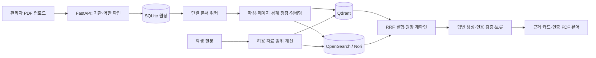

# 강의자료 RAG 검색

강의 PDF에 질문한 뒤 답변의 근거가 된 원문 페이지를 바로 확인하도록 만든 검색 서비스입니다. 용어가 정확히 기억나지 않을 때 자료를 다시 찾고, 답변을 원문과 대조하는 학습 흐름에 집중했습니다.

FastAPI·React/TypeScript로 문서 업로드, 기관별 접근 제어, 키워드·벡터·혼합 검색, 인용 검증과 답변 보류를 구현했습니다. SQLite와 단일 워커를 사용해 개인 개발자가 실행·관리할 수 있는 구성으로 정리했습니다.

## 현재 상태

2026-11-13 기준 Docker Desktop의 로컬 4서비스 실행과 GitHub Actions Linux Compose 통합·브라우저 검증을 완료했습니다. API 회귀 **156개**, 웹 테스트 **16개**, 실제 Qdrant·OpenSearch 통합 테스트 **5개**를 확인했습니다. 실제 OpenAI 임베딩과 구조화 답변·인용 검증, 근거 없는 질문의 보류도 확인했습니다.

- [검증 범위와 실행 기록](docs/reproducibility.md)
- [전체 Linux CI 성공 기록](https://github.com/ruddus11/lecture-rag/actions/runs/43382854896)
- [검색 평가와 한계](docs/evaluation.md)
- [네이티브 환경의 성능 측정](docs/performance.md)

위 결과는 개인 프로젝트의 기능 검증입니다. 운영 서비스의 보안 인증이나 일반적인 RAG 품질 평가를 의미하지 않습니다.

## 실행

Python 3.12와 Docker Compose가 필요합니다. Docker 가상 머신에는 메모리 8GB 이상을 권장합니다. 최초 빌드와 bge-m3 모델 다운로드에는 시간이 걸리고 디스크 공간이 필요합니다.

```bash
python3 scripts/prepare_env.py
# 기존 .env는 덮어쓰지 않습니다.
docker compose up --build -d
python3 scripts/wait_ready.py
```

웹은 http://localhost:3000 에서 열 수 있습니다. `/health/live`와 검색 모델·엔진까지 확인하는 `/health/ready`를 구분했습니다.

| 데모 계정 | 비밀번호 | 권한 |
|---|---|---|
| a_admin | admin-a-demo-2026 | campus_a 관리자 |
| a_student | student-a-demo-2026 | campus_a 학생 |
| b_admin | admin-b-demo-2026 | campus_b 관리자 |
| b_student | student-b-demo-2026 | campus_b 학생 |

관리자로 로그인 → 자료에서 컬렉션 선택 → `data/samples/`의 자작 PDF 업로드 → 사용 가능 상태 확인 → 질문 → 인용 카드 → PDF 원문 페이지 순으로 확인할 수 있습니다. 토큰은 메모리에 보관하므로 새로고침하면 다시 로그인합니다.

기본 답변 생성기는 API 키 없이 동작하는 `fake`입니다. 검색과 UI 검증용이며 생성 모델 품질을 나타내지 않습니다.

## 실제 OpenAI 답변

`.env`에서 아래 변수를 설정한 뒤 API를 다시 생성합니다. 실제 키는 로컬 파일에만 입력합니다.

```dotenv
ANSWER_PROVIDER=openai
OPENAI_CHAT_MODEL=gpt-4.1-mini
OPENAI_API_KEY=
```

```bash
docker compose up -d --force-recreate api
```

로컬 임베딩은 기본 bge-m3를 유지합니다. OpenAI 임베딩은 별도 smoke에서 `text-embedding-3-small` 1,536차원을 확인했습니다. 임베딩 모델을 바꿀 때는 기존 자료의 재색인이 필요합니다. Claude 어댑터도 구현했지만 실제 Anthropic 호출은 검증하지 않았습니다.

## 환경변수와 자료 경계

전체 변수는 [.env.example](.env.example)에 정리했습니다. 실제 비밀 값은 비워 두었습니다.

- `AUTH_SECRET`: 최초 준비 스크립트가 난수로 생성합니다. 운영 모드에서는 기본값·짧은 비밀로 시작할 수 없게 했습니다.
- `DATA_DIR`, `INSTITUTIONS_FILE`, `USERS_FILE`: 자료 저장소와 기관·계정 정책을 지정합니다.
- `QDRANT_URL`, `OPENSEARCH_URL`: 검색 엔진 연결 주소를 지정합니다.
- `CACHE_EMBED_TTL_SECONDS`, `CACHE_RETRIEVAL_TTL_SECONDS`: 평가 시 두 값을 0으로 설정했습니다.
- `ANSWER_PROVIDER`, `OPENAI_CHAT_MODEL`, `OPENAI_API_KEY`: 실제 생성 모델을 선택합니다. 호출 비용이 발생합니다.

`.env`, 실행 DB, 개인 수업 PDF, 내부 작업 문서와 원본 실행 로그는 공개 대상에서 제외했습니다. 공개 샘플과 평가 문항은 자작 자료입니다. 예제 계정은 로컬 데모용으로만 사용합니다.

## 구조



- `apps/api/app/`: 인증·권한, 문서 워커, 검색, 답변 생성과 저장소를 구현했습니다.
- `apps/web/src/`: 질문, 자료 목록, 인용 카드와 PDF 뷰어를 구현했습니다.
- `infra/`, `compose.yaml`: API·웹·Qdrant·OpenSearch 네 서비스를 구성했습니다.
- `config/`: 로컬 데모 기관·역할·계정 예제를 정리했습니다.
- `evaluation/`: 동결 dev/test 문항, 평가 도구와 자작 자료의 결과를 보관했습니다.
- `docs/`: 공개 아키텍처, ADR, 검증 요약과 한계를 정리했습니다.

삭제는 원장에서 접근을 먼저 차단한 뒤 인덱스·파일·청크를 정리했습니다. 기관 ID를 클라이언트 요청에서 그대로 신뢰하지 않고 서버가 매 요청의 허용 범위를 계산하도록 구현했습니다.

## 개발·검증

```bash
cd apps/api
uv sync --locked
uv run pytest
uv run ruff check .
uv run ruff format --check .
uv run mypy app
```

```bash
cd apps/web
npm ci
npm run lint
npm run typecheck
npm test
npm run build
```

실제 엔진 테스트는 개발용 loopback 포트를 사용합니다. 테스트는 고유 인덱스를 생성해 기존 자료와 분리했습니다.

```bash
docker compose -f compose.yaml -f compose.override.example.yaml up --build -d --wait
cd apps/api
uv run pytest -m integration
```

비밀 스캔은 `python3 scripts/check_secrets.py --history`로 실행합니다. 모든 비밀 유형을 탐지하는 도구는 아니므로 수동 확인도 필요합니다. GitHub Actions의 수동 `integration=true` 실행에서는 fresh Linux Compose와 브라우저 시나리오를 검증했습니다.

## 한계와 다음 작업

텍스트 PDF와 작은 자작 자료로 검증했습니다. 스캔·복잡한 표·다단 문서는 지원 범위 밖입니다. 동결 test 10문항에서 세 검색 방식 모두 높은 점수를 얻었지만, 쉬운 문항과 작은 표본이므로 방식 간 우열이나 실서비스 품질을 주장하지 않았습니다.

실제 LLM은 정상 질문·근거 없는 질문의 연결 확인을 완료했으며, 광범위한 인용 정확도·오보류율 평가는 남아 있습니다. 단일 프로세스·단일 워커, 정적 데모 계정과 내부 전용 검색 엔진 구성이므로 외부 운영 전에는 별도 인증·TLS·운영 정책이 필요합니다. 다음 작업은 허용된 실제 자료로 평가 문항과 예외 사례를 늘리는 것입니다.
