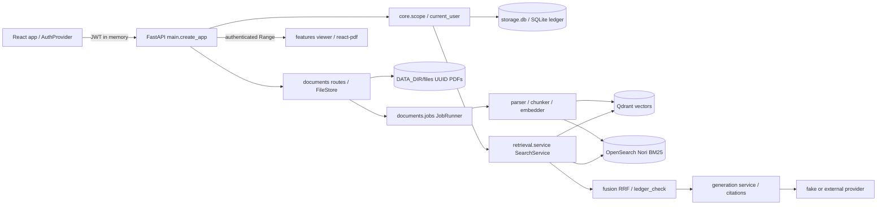

# 실제 구조와 데이터 흐름

## 경계

- `app/api/deps.py`는 현재 사용자와 DB 세션을 제공하고 `core/scope.py`가 매 요청 허용 컬렉션을 계산한다. 엔진 필터 후 `ledger_check`가 ready·active_version을 재확인한다.
- `app/documents/jobs.py`는 단일 워커다. SQLite가 작업·문서 상태의 기준이며 두 검색 엔진은 재구축 가능한 인덱스다. 업로드는 원장 등록 후 비동기 색인, 삭제는 접근 차단 후 물리 정리한다.
- `app/generation/`은 검색된 근거만 공급자에 전달하고 로컬 인용 ID·원문 quote를 검증한다. fake는 품질 평가용이 아니다.
- `core/body_limit.py`는 본문 21MiB, `storage/files.py`는 PDF 20MiB·경로 경계를 검사한다. CORS allowlist·요청 ID·로그 마스킹은 API 경계에서 적용한다.
- Compose 네 서비스 중 api/web만 loopback으로 공개한다. 개발용 override만 검색 엔진의 loopback 포트를 연다. Docker 내부 통신은 서비스 이름을 쓴다.

## 상태·실패

문서는 queued→processing→ready 또는 failed, 삭제는 deleting→deleted다. 재시도는 target_version을 증가시킨다. 검색 엔진 하나가 실패하면 hybrid는 degraded로 가능한 근거를 제공하고, 생성 실패는 보류로 처리한다. 웹의 loading/empty/error/validation은 각 feature가 표시한다.

단일 프로세스 구조는 솔로 운영에 적합하지만 다중 API 인스턴스·분산 큐·실시간 정책 편집 UI는 지원하지 않는다. 캐시 성능 변경은 M10 담당 브랜치에서 병합한다.
